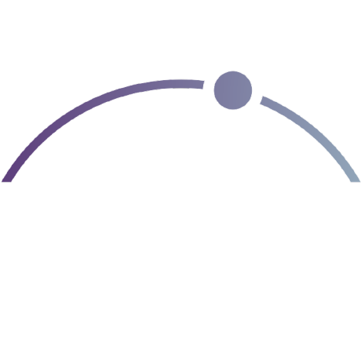

# Sam Rogers

I build tools that make coding agents prove their work and check what they're about to act on.

## Drop one into your workflow

| If you need to... | Use | First step |
|---|---|---|
| Check an agent's claims about a change before you merge it, locally or in CI | [Harnessie](https://github.com/snapsynapse/harnessie) | `pip install harnessie` and follow the [quick start](https://github.com/snapsynapse/harnessie#quick-start), or gate pull requests with the [Verify Action](https://github.com/snapsynapse/harnessie-verify-action#quickstart-the-safe-pattern) |
| Check an assistant setup guide before an agent acts on it | [GuideCheck](https://github.com/snapsynapse/guidecheck) | Clone it and run the standard-library Python verifier on a known-bad guide, per [Try it](https://github.com/snapsynapse/guidecheck#try-it) |
| Catch new accessibility regressions without failing on the debt you already have | [A11y Audit](https://github.com/snapsynapse/skill-a11y-audit) | [Install the skill](https://github.com/snapsynapse/skill-a11y-audit#install), then ask your agent to run an accessibility audit |
| Notice when an agent skill bundle has drifted from what you reviewed | [Skill Provenance](https://github.com/snapsynapse/skill-provenance), listed in [Awesome OpenClaw Skills](https://github.com/VoltAgent/awesome-openclaw-skills) | [Preview and install](https://github.com/snapsynapse/skill-provenance#quick-install) a pinned release with `gh skill` |
| Keep a sourced reference in Git and build its site, JSON API, and MCP interface from one source | [Knowledge as Code](https://github.com/snapsynapse/knowledge-as-code-template) | Clone it, then run `node scripts/init.js ../my-knowledge-base` per the [quick start](https://github.com/snapsynapse/knowledge-as-code-template#quick-start) |

If you try one, open an issue with what happened: the result you got, or where it stopped you. If it saved you time, a star helps the next person with the same problem find it.

## How I build

- I run a governed multi-model development practice: one vendor's agent writes, a different vendor's agent verifies, acceptance checks are stated before the work starts, and permission tiers sit at the server boundary. [How it works](https://sam-rogers.com/facilitator-in-the-machine). It's one operator's practice, not a claim about a team's production infrastructure.
- I contribute upstream when a project already does most of what I need, and credit what I build on. Five of my pull requests were merged across Nate B. Jones' [Open Brain](https://github.com/NateBJones-Projects/OB1/pulls?q=is%3Apr+author%3Asnapsynapse+is%3Amerged) and [Ringer](https://github.com/NateBJones-Projects/ringer/pulls?q=is%3Apr+author%3Asnapsynapse+is%3Amerged), including Obsidian import, local Ollama embeddings, graceful shutdown with regression tests, and a Pages [deployment workflow](https://github.com/NateBJones-Projects/OB1/pull/342).
- Even my [resume](https://github.com/snapsynapse/resume) is an open codebase, with an [evidence ledger](https://github.com/snapsynapse/resume/blob/main/EVIDENCE.md) that states what each claim rests on and where it stops. It's also the place to start for an in-house role.

More tools

| Project | Use it when... |
|---|---|
| [Agentlink](https://github.com/snapsynapse/agentlink) | One `AGENTS.md` needs to reach every AI coding tool through symlinks, not generated copies; continues Martin Mose Facondini's [original project](https://github.com/snapsynapse/agentlink/blob/main/NOTICE) |
| [Delegated Watch](https://github.com/snapsynapse/delegated-watch) | Work delegated to AI models needs a local-first record, counted in tokens, that won't lower a committed number without a stated reason |
| [AI Tool Watch](https://github.com/snapsynapse/ai-tool-watch) | AI capability claims need a plain-language, model-checked reference |
| [HardGuard25](https://github.com/snapsynapse/hardguard25) | Identifiers need to be safer for people to read and transcribe |
| [PrompterKit](https://github.com/snapsynapse/prompter-kit) | Elgato Prompter scripts need text import, export, or a local library backup; builds on an MIT-licensed importer; maintenance-only |
| [substack2md](https://github.com/snapsynapse/substack2md) | A Substack reading archive needs to become local, Obsidian-friendly Markdown |

Specs, patterns, and data projects

| Project | Use it when... |
|---|---|
| [Turnfile](https://github.com/snapsynapse/turnfile) | Peer agents need auditable disagreement, explicit turns, and human-governed resolution |
| [AIDR](https://github.com/snapsynapse/aidr) | A consequential AI-assisted decision needs positions, preserved dissent, and human arbitration in one file |
| [Graceful Boundaries](https://github.com/snapsynapse/graceful-boundaries) | A service needs to communicate operational limits clearly to people and agents |
| [EveryAILaw](https://everyailaw.com/) | Software needs structured, source-linked AI law data |
| [AI Incident Law](https://github.com/snapsynapse/ai-incident-law) | AI-related legal and regulatory incidents need searchable, source-linked public tracking |
| [Obligation First](https://github.com/snapsynapse/obligation-first) | Laws, cases, and agreements need machine-readable structure around who owes what to whom |
| [PubLedge](https://github.com/snapsynapse/publedge) | Public interpretations and notices need verifiable, hash-pinned publication records |
| [Siteline](https://siteline.to/) | A website needs an agent-usability scan |
| [PAICE](https://paice.work/) | A team wants behavioral evidence about how people work with uncertain AI output |
| [AI Posture](https://github.com/snapsynapse/ai-posture) | A team needs a shared mental model for aggregated intelligence; a supporting framework, not a scored product |

[Browse all public repositories](https://github.com/snapsynapse?tab=repositories)

## Why

I'm here to improve how different intelligences work together, so our decisions get wiser, not just smarter. The tools above are the part of that you can install. The rest happens in public conversation on [Signals & Subtractions](https://sigsub.show/), in [longer writing](https://sam-rogers.com/), and in [client work](https://snapsynapse.com/?utm_source=github&utm_medium=profile).

- Mission funding or partnership: [PAICE.work PBC](https://paice.foundation/#support), which I founded.
- Open-source sponsorship supports the specifications, tests, and public tooling: [GitHub Sponsors](https://github.com/sponsors/snapsynapse).
